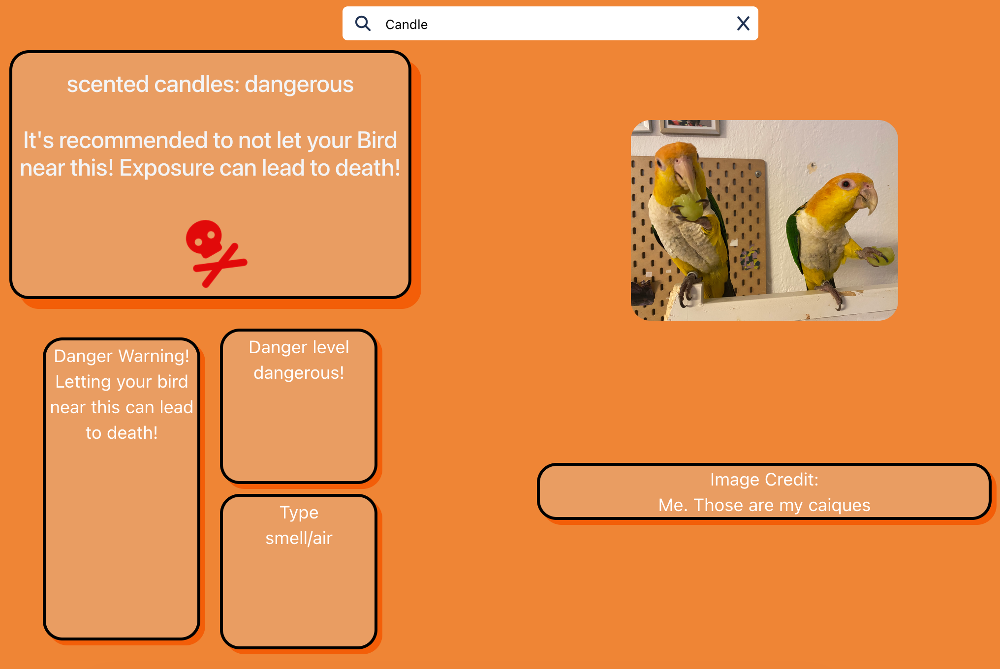

# Can My Bird Eat This
## Description
This site helps you find out if something is safe for your bird

Please note that this is not a finished project and may not display well on all screen sizes!

## Languages
- React: Logic
- CSS: Design
- SQLite: Database
- Node.js: backend, connects to the database

## How to run server and website?
1. Clone the repository
2. Start the server by navigating into the Folder <b>backEnd</b> via terminal. Run the command "<b>npm start </b>

        <i>cd backEnd 
        npm start</i>

Do not close that Terminal Window!

3. Using a second Terminal window, navigate into the Folder <b>frontEnd</b>. Run the command "<b>npn run dev</b>

        <i>cd frontEnd 
        npm run dev </i>

4. Open the side via "<i>http://localhost:...</i>" link that the terminal provides

## Preview

